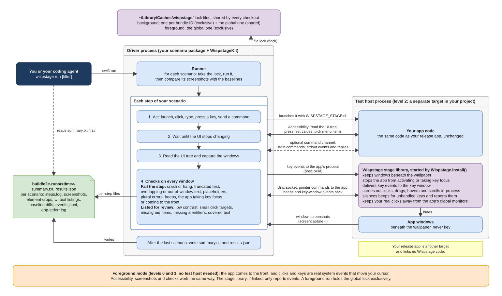

<div align="center">

# Wispstage

**Lightweight end-to-end testing for SwiftUI Mac apps, built for coding agents.**

Your coding agent sets it up, writes the tests, runs them in the background and reads the results,<br>
for a fraction of the tokens a screenshot-driven agent spends. Your cursor and keyboard stay yours.

[](https://github.com/yales66/wispstage/actions/workflows/ci.yml)
[](LICENSE)


[Quick start](#quick-start) · [What your agent reads](#what-your-agent-reads) · [What it checks](#what-it-checks) · [How it works](#how-it-works) · [Measuring animations](#measuring-animations) · [中文说明](README.zh-CN.md)

</div>

Wispstage is a Swift package and a Claude Code plugin. You ask your agent for end-to-end tests. The plugin's skill shows it how to add Wispstage to your project, write scenarios in Swift, run them against your real app and read a plain-text summary of what broke. Your part is granting two macOS permissions and reading what the agent reports. It was built while testing a production Mac app with coding agents.

The agent adds two things to your project: a scenario package, a small Swift package where the scenarios live, and, for background runs, a test host, a second app target built from your app's code that links Wispstage's stage library. In background mode the stage library keeps the app's windows beneath the desktop wallpaper; without a test host, runs use foreground mode and take over the screen.

- Agents pay little to use it. A whole suite is one command, with no model call per click, and reading a passing 19-step run costs about 300 tokens, more than 99% less than looking at a screenshot after every step.
- It is light. There is no virtual machine and no UI test bundle, only the scenario package and test host the agent adds; the command-line tool is 2.1 MB, and the checks add 0.2 to 1 s per step.
- It tests end to end, on your Mac. One `wispstage run` drives your actual app through Accessibility and synthesized input. Once the test host is in, runs happen in background mode: the app's windows stay beneath the wallpaper and never take focus, so you keep working while the suite runs.
- It is built for SwiftUI. Identifiers come from `.accessibilityIdentifier`, the background-mode test host is a few lines around your `App`, and animations are compared with SwiftUI's own spring presets. AppKit apps work too.
- Every step is checked, with no assertions to write. Crashes, hangs, truncated or overlapping text, text outside its window, unfilled placeholders and beeps from unhandled keys fail the step on their own. Low contrast, tiny click targets and missing identifiers are listed for review.
- Your release build stays clean. Scenarios live in their own package and the stage library links only into the test host, so your release app links nothing from Wispstage.



<sub>[Editable source](docs/architecture.drawio)</sub>

## Quick start

### 1. Install the plugin

From a terminal:

```bash
claude plugin marketplace add yales66/wispstage
claude plugin install wispstage@wispstage
```

The plugin gives Claude the `wispstage` command and a skill that covers adoption, writing scenarios, running and reading results. The first `wispstage` call builds the command-line tool, which takes about a minute; later calls start in 0.03 s.

### 2. Grant two permissions

In System Settings → Privacy & Security, grant **Accessibility** and **Screen Recording** (called **Screen & System Audio Recording** on macOS 15 and later) to the terminal app that runs Claude Code. Only you can do this; `wispstage run` checks before it starts and names whatever is missing.

You need macOS 14 or later and a Swift 6 toolchain (Xcode 16 or later).

### 3. Ask your agent

```text
Add end-to-end tests to this app with Wispstage.
```

From there the agent works through the [adoption levels](#adoption-levels): it scaffolds a scenario package, adds accessibility identifiers, adds a test host so the suite can run in the background, and writes scenarios for the flows you care about. Each level is an ordinary code change you can review. Other things you can ask for:

```text
Run the settings scenarios and fix whatever fails.
Find the controls in the main window that have no accessibility identifier and add them.
Check that the sidebar opens with a .snappy spring of 0.3 s.
Accept this run's screenshots as the new baselines.
```

Before the test host exists, a run has to use foreground mode, which takes over your screen, keyboard and cursor; the skill tells the agent to ask you first. Once the test host is in, every run happens in the background.

## What your agent reads

After a run, the agent opens one file, `summary.txt`:

```
MyApp E2E  2026-10-15T10:15:00Z
Run mode: background
Input: inprocess
Full-window screenshots: key
Passed: 1  Failed: 1  Skipped: 1  Interrupted: 0  Known failures: 0

Skipped in background mode (1, run with --mode foreground to test them):
  hotkeys.global @01-launch: Step needs foreground mode: global hotkeys need system keyboard events

Passed  smoke.launch  (4.8s, 4 steps)
Failed  settings.save  (9.1s, 7 steps)
      Failed step: 04-open-settings
      Reason: [truncation] settings#4512 "Notify me when a session ends"(412,318 180x16) is truncated: recognized "Notify me when a sess…" in the screenshot, with an ellipsis
      Crop [truncation] failed @ 04-open-settings "settings.notify": /Users/me/MyApp/build/e2e-runs/20261015-101500/settings.save/04-open-settings-settings.notify.png
      Missing identifier (1, listed for review):
        @04-open-settings Button"Advanced…" (16,240 96x20)
Skipped  hotkeys.global  (1.2s, 1 step)
      Skipped at: 01-launch
      Reason: Step needs foreground mode: global hotkeys need system keyboard events
```

Nobody wrote an assertion about truncation in `settings.save`. The check runs after every step, and the summary points at a crop of the label that was cut off. Steps are numbered in the order they ran (`04-open-settings`), windows are named by kind and window number (`settings#4512`), and frames read `(x,y width x height)` in points. `Input: inprocess` means pointer input was carried out inside the app.

Only when something fails does the agent open more: that step's UI as text (`.ax.txt`, with exact identifiers and strings), and if the text cannot answer, a crop of one element instead of the whole window. The skill teaches it that order.

| What the agent reads | Screenshot every step | With Wispstage | Reduction |
|---|---|---|---|
| A 19-step run that passes | 38,000 to 88,000 tokens | About 300 tokens: `summary.txt` | More than 99% |
| A 19-step run where one scenario fails | 38,000 to 88,000 tokens | About 3,000 tokens: the summary, the failing step's text listing and one element crop | 92% to 97% |
| One element it needs to see | 2,000 to 4,600 tokens for the whole window | About 45 tokens for a label, 650 for a card | 68% to 99% |

The figures are estimates from file sizes: a Retina window of 2400×1488 pixels, one token per 28×28 pixels of image, and 3 to 4 bytes of text per token. The low end of each range assumes a model that scales a large screenshot down to 1,568 pixels on its long side before reading it; the high end assumes the full-size image.

## How it compares

| While a suite runs | XCUITest | Computer-use agent | Wispstage, background mode |
|---|---|---|---|
| Your cursor and keyboard | Taken over | Taken over | Yours |
| The app's windows | In front | In front | Beneath the wallpaper |
| Model calls | None | One per action, with a screenshot | None; the agent reads one summary afterward |
| What your project needs | A UI test target | Nothing | A scenario package and a test-host target, which the agent adds |

A macOS virtual machine also leaves your desktop alone, at the cost of a second macOS install (tens of GB on disk, several GB of RAM while it runs) and a limit of two macOS guests per Mac under Apple's license. Wispstage runs the app in your own session instead:

| | Measured |
|---|---|
| Command-line tool | 2.1 MB binary, 157 MB build cache in `~/Library/Caches/wispstage/` |
| Inspecting a running app (`windows`, `listing`, `shot`) | 0.09, 0.14 and 0.37 s; 13, 13 and 67 MB of memory at peak (M2 MacBook Air) |
| Checks after each step | 0.2 to 1 s, mostly waiting for the UI to settle |
| The app beneath the wallpaper | Its animations still ran at 60 frames per second |

Choose a virtual machine when every run must start from a clean system image. Choose Wispstage for many quick runs on the Mac you work on; [adoption level 3](#adoption-levels) keeps those runs away from your real data.

## What the agent writes

Scenarios are plain Swift in the scenario package, one file per area of your app, so you can read and edit what the agent wrote. A typical file, `E2E/Sources/<product>/SettingsScenarios.swift`:

```swift
import WispstageKit

let settingsScenarios: [Scenario] = [
    scenario("settings.save") { t in
        try t.launch(LaunchSpec(executable: t.configuration.defaultExecutable), step: "launch")
        try t.press(id: "main.openSettings")
        try t.window(.settings)
        try t.setValue("settings.name", "Ada", submit: false)
        try t.press(id: "settings.save")
        try t.waitGone(.settings)
        try t.expect(try t.text(of: "main.greeting") == "Hello, Ada", "the greeting uses the saved name")
        try t.shot(id: "main.greeting")
    },
]
```

Each file's array is added to `allScenarios` in the package's `main.swift` (`smokeScenarios + settingsScenarios`).

`t.press(id:)` and `t.press(label:role:)` perform an element's accessibility action and need no pointer. Calls that take a target, such as `t.click`, `t.setValue` and `t.shot`, read a string as an accessibility identifier and accept `.label("Save", role: .button)` to find an element by its text; `t.click` is for controls that respond only to the mouse. `setValue` presses Return after typing unless it gets `submit: false`. Each action is one step: it is logged, the UI is allowed to settle, and the checks run.

`.settings` is a window kind. A window gets its kind from an identifier such as `settings.window`, or from a title containing "Settings"; [api.md](skills/wispstage/references/api.md#targets-target) shows how to add more kinds.

### Known failures

`t.expectFailure("BUG-12") { … }` records a failure inside the block as a known failure, so the rest of the scenario still runs. When the block stops failing, the summary says the bug may be fixed.

### Reading app state

The test host can read one command per line on standard input and answer on standard output with three kinds of line. The commands are yours to define, and the app must flush standard output after each line, because a pipe is block-buffered:

| Line the app writes | Meaning |
|---|---|
| `WISPSTAGE_EVENT {"type":"item.saved","id":3}` | An event; `type` is required |
| `WISPSTAGE_STATE <content>` | A reply named `STATE` (any uppercase name works) |
| `WISPSTAGE_ERROR <reason>` | An error; the command that caused it fails |

Scenarios then drive the app and wait on it:

```swift
try t.send("advance 600")                                   // e.g. move a fake clock forward
let state = try t.request("dump-state", reply: "STATE")    // returns <content>
try t.waitEvent("item.saved", where: { $0["id"] as? Int == 3 })
```

### Baselines

`t.shot("name")` keeps a full-window screenshot and `t.shot(id:)` crops one element. `wispstage baseline accept <run-dir>` saves a run's screenshots as baselines. To keep separate baselines per language, appearance or clock format, a scenario launches with a variant name, such as `LaunchSpec(…, variant: Baselines.variant(language: "en", appearance: .dark, hour24: true))`, which files them under `en-dark-24h/`.

### Hooks and configuration

`E2EHooks` runs code before each launch (and can refuse it) and after each stop. `E2EConfiguration` sets the run and baseline folders, your localization keys for the placeholder check, and the text recognition languages for the truncation check; a Chinese UI adds `zh-Hans`.

The full API is in [`skills/wispstage/references/api.md`](skills/wispstage/references/api.md).

## What it checks

After every action step, on every window of the app:

| Fails the step | Listed in the summary, does not fail |
|---|---|
| A crash, or no accessibility response within 5 s | Text contrast below WCAG 4.5:1 (3:1 for large text) |
| Truncated text, found by text recognition on the window and confirmed on a crop of the element | Click targets smaller than 20×20 pt |
| Overlapping text | Siblings in a column that are not aligned |
| Text outside its window | Visible elements without an accessibility identifier |
| Placeholder text that was never filled in: `%@`, `{name}`, raw localization keys | Text partly covered by another view |
| "1" followed by a plural noun, such as "1 Minutes", in an English UI | |
| A beep from a key press the app does not handle (level 2) | |
| In background mode: a window becoming key, or the app coming to the front | |

When a scenario ends, its screenshots are compared with the accepted baselines. Differences are listed with a highlight image for a person to judge, and do not fail the scenario.

Only the beep check and the background-mode focus checks need a test host; every other check works at level 0. To accept a known exception, a scenario calls `t.waive(.truncation, reason: "…")`, which waives one check for the next step or for a block.

## How it works

A background-mode run, as drawn in the [architecture diagram](#wispstage) at the top, goes like this:

1. `wispstage run` finds `.wispstage.json` and starts the scenario package with `swift run`. That process is the driver: the scenarios compiled together with WispstageKit.
2. For each scenario the runner takes a lock, then runs the scenario. Its launch step starts the test host with `WISPSTAGE_STAGE=1`, and the stage library inside the test host keeps the windows beneath the wallpaper and stops the app from activating or taking key focus.
3. The driver reaches the app in four ways:
   - Accessibility, to read the UI tree, press buttons, set values and pick menu items.
   - Key events sent to the app's process. The stage library delivers them to the key window, so Esc cancels and Return presses the default button.
   - A Unix socket to the stage library. Pointer commands go to the app and are carried out inside it; beeps and key-window events come back.
   - An optional command channel on the app's standard input and output, for state and events the scenarios ask for.
4. After each action the driver waits until the UI stops changing, reads the UI tree, captures the windows and runs its checks. When a scenario ends it compares the scenario's screenshots with the accepted baselines; when the last one ends it writes `summary.txt` and `results.json`.

### Background and foreground mode

| | Background (default) | Foreground |
|---|---|---|
| Your Mac | You keep working: the cursor stays put, focus stays where it is, no beeps | Screen, keyboard and cursor are taken for the run, after a 5-second countdown |
| App windows | Beneath the wallpaper, never key | In front, with real key focus |
| Input | Accessibility actions, key events sent to the app's process, pointer input carried out inside the app | Accessibility actions, real mouse and keyboard events |
| Needs | A test host that links the `Wispstage` library, packaged as an `.app` | Nothing |
| Runs alongside | Background runs of apps with other bundle identifiers | Nothing; it waits for every other run on the Mac |

In background mode a scenario stops at the first `t.requireForeground(...)` or `t.globalKey(...)` call, and `summary.txt` lists it under `Skipped in background mode`. After each background scenario the driver checks that the system cursor is where it was; if the run moved it, the scenario fails, and if you moved the mouse yourself, the position is not judged. In a foreground run, moving the cursor during a step makes the step wait until the cursor is still and retry once; a second move records the scenario as interrupted.

### Adoption levels

The agent takes your app up these levels one at a time. Each one is a small change you can review.

| Level | What changes | What you get |
|---|---|---|
| 0 | Nothing in the app. `wispstage init` adds a scenario package | Foreground runs; elements found by text and role |
| 1 | Accessibility identifiers named `area.element`, such as `settings.save` | Scenarios that survive copy changes and localization |
| 2 | A test-host target that links `Wispstage` and calls `Wispstage.install()` after creating `NSApplication`, before `run` | Background runs and beep detection |
| 3 | Calendar, notifications, authorization, clocks and network behind protocols, with test doubles in the test host | Runs that never touch your data or show permission prompts |

### The test host

Wispstage ships two libraries. `WispstageKit` is what the scenario package uses. `Wispstage` is the stage library, and only the test host links it.

The test host is a second executable target built from the same app code as your release app; the suite launches it instead of your release build. For a SwiftUI app in a Swift package, the agent moves the app into a library target and gives the release app and the test host one entry point each:

```swift
// Package.swift
dependencies: [.package(url: "https://github.com/yales66/wispstage", from: "0.1.0")],
targets: [
    .target(name: "MyAppKit"),                                    // the app itself
    .executableTarget(name: "MyApp", dependencies: ["MyAppKit"]), // release entry point
    .executableTarget(name: "MyAppTestHost", dependencies: [
        "MyAppKit", .product(name: "Wispstage", package: "wispstage"),
    ]),
]
```

```swift
// Sources/MyAppKit/MyApp.swift: the App struct, public and without @main
import SwiftUI

public struct MyApp: App {
    public init() {}
    public var body: some Scene { WindowGroup { ContentView() } }
}

// Sources/MyApp/main.swift (release)
import MyAppKit
MyApp.main()

// Sources/MyAppTestHost/main.swift
import AppKit
import Wispstage
import MyAppKit

MainActor.assumeIsolated {
    _ = NSApplication.shared
    _ = Wispstage.install()   // after NSApplication exists, before the app runs
    MyApp.main()
}
```

In an Xcode project the idea is the same: take `@main` off the `App` struct, add a second app target that compiles the same source files plus its own `main.swift` (without `import MyAppKit`), and add the Wispstage package to that target only.

Background mode needs the test host inside an `.app` bundle: the driver reads the bundle identifier from it, and macOS treats a bare executable as part of the terminal that started it. An Xcode build already produces an `.app`. A `swift build` product is bare, so the scenario package's `main.swift` wraps it:

```swift
defaultExecutable: try PreviewBundle.prepare(
    executable: projectDir.appendingPathComponent(".build/debug/MyAppTestHost"),
    in: projectDir.appendingPathComponent("build/e2e-bundle"),
    bundleID: "com.example.MyApp.testhost", name: "MyApp Test Host"),
```

`prepare` copies the executable into an `.app` with that bundle identifier, recopies it only when it changes, and returns the executable inside the bundle. The [integration guide](skills/wispstage/references/integration.md) that the skill follows covers every level in detail, including an AppKit test host.

## Measuring animations

`t.recordMotion` measures an animation the way a user sees it, frame by frame and from outside the app, and compares it with the spring your design calls for. Your agent gets numbers to check an animation against the spec instead of a pile of frames to look at. It works in background mode too: the screen capture composites only the app's window, so the wallpaper above it hides nothing.

```swift
let lift = MotionSpec(name: "Lift", anchor: .firstMove, track: .moving, source: "Design spec §3",
                      expectations: [MotionExpectation(.scale, from: 1, to: 1.03, spring: MotionSpring(.snappy, duration: 0.25))])
let drop = MotionSpec(name: "Drop", anchor: .release, track: .moving, source: "Design spec §3",
                      expectations: [MotionExpectation(.scale, to: 1, spring: MotionSpring(.snappy, duration: 0.35))])
try t.recordMotion("reorder", ids: ["list.row.a"], specs: [lift, drop]) {
    try t.drag(from: "list.row.a", to: .offset(dx: 0, dy: 120))
}
```

This drags a list row down by 120 points and checks two things: that the row lifts to 103% with a `.snappy` spring of 0.25 s when the drag starts, and that it settles back to 100% with a 0.35 s spring after the drop.

### How it measures

Each identified element is followed in two ways. Its accessibility frame is read every 2 ms. Its pixels are captured at up to 120 frames per second and followed by template matching, which also tracks what the accessibility tree does not report, such as the floating copy of a dragged row, and measures opacity. Both share one clock.

Recording goes on after the block returns until the element has been still for 0.3 s, at least 1 s after the pointer is released and at most 5 s, so the whole settle is captured. Each spec measures time from one of three anchors; `.firstMove` and `.release` start at the first frame that changes, not at the moment the input arrived:

| Anchor | Time zero |
|---|---|
| `.start` | The start of the recording |
| `.firstMove` | The first change after the interaction starts, such as a lift |
| `.release` | The first change after the pointer is released, such as a drop |

`track: .moving` compares the element that moved the most between that anchor and the next; `.original` uses the first identifier's accessibility frame, and `.named("list.row.a~capture")` picks one track by name.

### What a spec checks

An expectation names a channel (`x`, `y`, `width`, `height`, `scale` or `opacity`), the value it should end at, optionally where it starts, and optionally a spring: `.snappy`, `.smooth` or `.bouncy` with a duration, the presets of SwiftUI's `Spring`.

| Item | Checked when | Tolerance |
|---|---|---|
| End value of `x`, `y`, `width`, `height` | Always | ±0.5 pt |
| End value of `scale`, `opacity` | Always | ±0.01 |
| Time to reach 95% of the end value, against the spring's curve | A spring is given | ±42 ms |
| Overshoot past the end value | A spring is given | ±0.9 percentage points for moves up to 50 pt, ±0.15 above |
| Largest deviation of any frame from the spring's curve | A spring is given | Same as the end value |

`minPointerTravel:` adds one more check: when the element starts to change, it must already be at least that many points from where it started. A difference smaller than one captured pixel can show is reported as `below resolution, not judged`. The comparison goes into `motion-<name>.txt` and `steps.log`, not into `summary.txt`, and a difference does not fail the step; the agent reads `motion-<name>.txt` to judge the animation.

### What it writes

| File | Contents |
|---|---|
| `motion-<name>.txt` | For each spec, every item as spec, measured value and difference, with values outside tolerance marked; then, for each element, when it started changing, when it reached 95% and how far it overshot |
| `motion-<name>.png` | A filmstrip per spec at 0, 50, 100, 150, 250 and 400 ms after time zero (`stills:` changes the offsets) |
| `motion-<name>.jsonl` | Every reading: time, element, source, position, size, scale and opacity |
| `motion-<name>-frames/` | Every captured frame, when `WISPSTAGE_MOTION_FRAMES=1` is set |

## Reading the results

Each run writes `build/e2e-runs/<time>/` with `summary.txt`, `results.json` and one folder per scenario:

| File | Contents |
|---|---|
| `steps.log` | Every step, wait and check |
| `NN-<step>.ax.txt` | The step's UI as text, one line per element with role, identifier, text and frame; read this first |
| `NN-<step>.png` | Full-window screenshots, chosen by `--shots` |
| `NN-<step>-<element>.png` | Element crops from `t.shot(id:)` and from failed checks |
| `<shot>.diff.png` | Pixel differences against the baseline |
| `ax-<step>.txt`, `NN-<step>-failed.png` | When a step fails: a raw dump of every window's accessibility tree, and a screenshot |
| `events.jsonl`, `app-stderr.log` | The app's events and standard error |

`--shots=key` (the default) keeps full-window screenshots of the first, last and failing steps; `all` keeps every step; `none` keeps none, though crops of failed checks are still written. Explicit `t.shot` calls always take their screenshots.

`wispstage run` exits with 0 when nothing failed, 1 when a scenario failed or a permission is missing, 2 when no scenario matched or an argument is invalid, and 75 when the screen is locked before the run starts. Skipped and interrupted scenarios do not change the exit code.

## Running suites in parallel

Each scenario takes a lock in `~/Library/Caches/wispstage/` before it starts and waits while the lock is held.

| How you run | What runs at the same time |
|---|---|
| Foreground | Nothing else on the Mac |
| Background | Every background run whose test app has a different bundle identifier |
| Background, same bundle identifier | One scenario at a time; the runs take turns |

Give the test host in each git worktree its own bundle identifier, and agents working in different worktrees can run their suites side by side, each app with its own sandbox container and preferences.

## Running it yourself

Wispstage works without an agent too. Outside Claude Code, clone this repository and link `bin/wispstage` into your `PATH`. Then build your app and point `init` at the executable. For a Swift package:

```bash
cd MyApp                                   # your project root
swift build
wispstage init --app-name MyApp --executable .build/debug/MyApp
wispstage run --mode foreground smoke.     # runs scenarios whose names start with "smoke."
```

For an Xcode project, build into the project folder and pass the executable inside the `.app`:

```bash
cd MyApp
xcodebuild -scheme MyApp -derivedDataPath build/xcode build
wispstage init --app-name MyApp --executable build/xcode/Build/Products/Debug/MyApp.app/Contents/MacOS/MyApp
wispstage run --mode foreground smoke.
```

`init` creates a scenario package in `E2E/` with a smoke scenario, and a `.wispstage.json` at the project root. It never overwrites a file that exists. `wispstage run` builds the scenario package but not your app, so rebuild the app before each run after you change it.

The default mode is background, which needs the test host; until you add one, pass `--mode foreground`, or every scenario fails at launch. In the generated `E2E/Sources/…/SmokeScenarios.swift`, set `anchorID` to an accessibility identifier your app has; until you do, the smoke scenario falls back to the first static text it finds.

`init` points `E2E/Package.swift` at the copy of Wispstage that ran it (the plugin's install folder, or your clone) by absolute path. Before you commit it, switch to the published package so the path works on other machines: `.package(url: "https://github.com/yales66/wispstage", from: "0.1.0")`, and `package: "wispstage"` in the `.product(name: "WispstageKit", …)` entry.

## Commands

<details>
<summary>All commands</summary>

| Command | What it does |
|---|---|
| `wispstage init [--app-name N] [--executable PATH] [--dir DIR]` | Scaffold a scenario package (default `E2E/`) with a smoke scenario, and a `.wispstage.json` at the project root; never overwrites existing files |
| `wispstage list [filter…]` | Build the scenario package and list scenario names, without launching the app |
| `wispstage run [--mode foreground\|background] [--shots=key\|all\|none] [filter…]` | Run scenarios whose names equal or start with a filter (`smoke.`, `settings.save`); no filter runs all. The mode can also come from `WISPSTAGE_MODE` |
| `wispstage baseline accept <run-dir> [filter…]` | Save a run's screenshots as baselines |
| `wispstage summary <run-dir>` | Rewrite `summary.txt` from `results.json` |
| `wispstage windows (--pid N \| --bundle-id ID)` | List the on-screen windows of a running app |
| `wispstage listing (--pid N \| --bundle-id ID) [--out FILE]` | Write a running app's UI as text and list visible elements without an identifier |
| `wispstage shot (--pid N \| --bundle-id ID) [--window ID] [--id IDENT] [--out DIR]` | Screenshot every window of a running app, one window with `--window`, or one element with `--id` |

`list`, `run` and `baseline` find `.wispstage.json` in the current directory or a parent and pass their arguments to the scenario package it names:

```json
{"scenarioPackage": "E2E", "product": "myapp-e2e"}
```

</details>

## Limitations

- Wispstage sees what the app exposes to Accessibility. Custom-drawn content such as games and canvas charts can be compared against baselines but not inspected, and an overlay missing from the accessibility tree is invisible to the occlusion check.
- Background mode cannot reproduce behavior that depends on an active window: focus rings and active-window colors, a first click that only activates, input-method composition such as Pinyin, real hover, global hotkeys. Those scenarios run in foreground mode.
- Runs need an unlocked screen, and they share CPU and memory with whatever else you are doing.
- The truncation check misses a label that is cut by less than a tenth of its text and shows no ellipsis.
- The plural check looks only for "1" followed by a plural noun, and only in an English UI.
- Beeps that AppKit plays outside its "no responder for this key" path are not detected.
- Motion recording cannot measure shadows, assumes a uniform background behind an element when it measures opacity, compares against springs only (no linear or ease-in-out curves), and records the window of the first identifier only. Its tolerances are set for solid-colored elements; text and shadows on an element make the pixel track less precise.
- Hiding windows beneath the wallpaper and delivering key events inside the app rely on how the macOS window server and AppKit behave today; a macOS update can change that.
- macOS only.

## Development

```bash
swift test
```

Tests that need a graphical session or Screen Recording skip themselves on a machine without one. `.github/workflows/ci.yml` builds and tests on a GitHub macOS runner. The skill lives in `skills/wispstage/` and the plugin manifest in `.claude-plugin/`.

## License

MIT. See [LICENSE](LICENSE).
