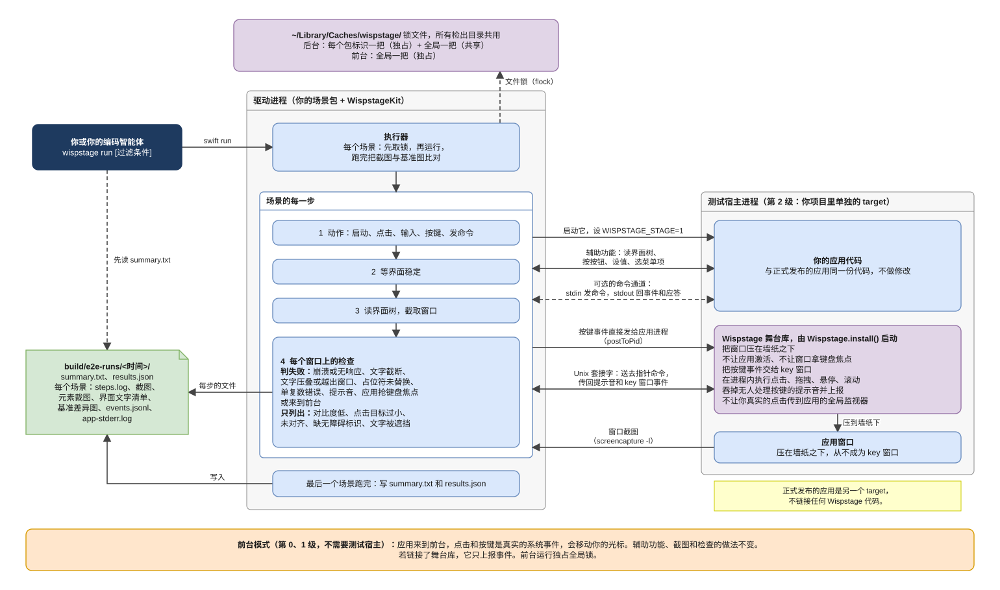

<div align="center">

# Wispstage

**为编码智能体打造的 SwiftUI Mac 应用轻量端到端测试。**

接入、编写测试、在后台运行、读取结果，都由你的编码智能体完成，<br>
花的 token 只是靠截图操作的智能体的零头。光标和键盘仍归你用。

[](https://github.com/yales66/wispstage/actions/workflows/ci.yml)
[](LICENSE)


[快速上手](#快速上手) · [试试示例](#先在示例应用上试试) · [智能体读什么](#智能体读什么) · [检查项](#检查项) · [工作原理](#工作原理) · [测量动效](#测量动效) · [English](README.md)

<br>


</div>

Wispstage 是一个 Swift 包，也是一个 Claude Code 插件。你请智能体加上端到端测试，插件里的技能会告诉它怎样把 Wispstage 加进你的项目、用 Swift 编写场景（scenario）、对着你真实的应用运行这些场景，再读一份纯文本摘要，看哪里坏了。你要做的是授予两项 macOS 权限，再读智能体的汇报。Wispstage 诞生于用编码智能体测试一款正式上线的 Mac 应用的过程中。

智能体会往你的项目里加两样东西。一是场景包（scenario package），存放场景的小型 Swift 包。二是测试宿主（test host），供后台运行使用：它是用你的应用代码构建的第二个应用 target，链接 Wispstage 的舞台库（stage library）。在后台模式下，舞台库让应用的窗口始终压在桌面墙纸之下；没有测试宿主时，运行使用前台模式，占用整个屏幕。

- 智能体用起来开销小。整套测试只要一条命令，不必每次点击都调用一次模型；读一次 37 步全部通过的运行的摘要约花 2,800 个 token，比每一步之后看一张截图少 98%。
- 它很轻。没有虚拟机，也没有 UI 测试 target，只有智能体加进来的场景包和测试宿主；命令行工具 2.1 MB，各项检查让每一步多花 0.2 到 1 s。
- 它做端到端测试，就在你的 Mac 上。一条 `wispstage run` 通过辅助功能（Accessibility）和合成输入操控你真实的应用。测试宿主就位后，运行都在后台模式下进行：应用的窗口始终压在墙纸之下，从不抢焦点，测试套件运行期间你照常干活。
- 它为 SwiftUI 而做。标识来自 `.accessibilityIdentifier`，后台模式的测试宿主只是在你的 `App` 外面加几行代码，动画则用 SwiftUI 自己的弹簧预设来比对。AppKit 应用同样能用。
- 每一步都会检查，不用写断言。崩溃、卡死、文字被截断或互相压叠、文字越出窗口、占位符未替换，以及无人处理的按键发出的提示音，都会直接判该步失败。对比度过低、点击区域过小和缺少无障碍标识则列出来供复查。
- 正式构建保持干净。场景放在自己的包里，舞台库只链接进测试宿主，所以正式发布的应用不链接任何 Wispstage 代码。



<p align="center"><sub>Wispstage 架构图</sub></p>

## 快速上手

### 1. 安装插件

在终端里：

```bash
claude plugin marketplace add yales66/wispstage
claude plugin install wispstage@wispstage
```

插件给 Claude 提供 `wispstage` 命令，并附带一个技能，涵盖接入、编写场景、运行和解读结果。首次调用 `wispstage` 会构建命令行工具，大约需要一分钟；之后的调用 0.03 s 就能启动。

### 2. 授予两项权限

在「系统设置 → 隐私与安全性」中，给运行 Claude Code 的终端应用授予**辅助功能**和**屏幕录制**权限（macOS 15 起这一项叫**录屏与系统录音**）。这一步只有你能做；`wispstage run` 启动前会检查权限，缺哪项就报出哪项。

需要 macOS 14 或更高版本，以及 Swift 6 工具链（Xcode 16 或更高版本）。

### 3. 告诉你的智能体

```text
用 Wispstage 给这个应用加上端到端测试。
```

之后智能体按[接入级别](#接入级别)逐级推进：搭建场景包，添加无障碍标识，加上测试宿主让测试套件能在后台运行，再为你关心的流程编写场景。每一级都是一次普通的代码改动，你可以审阅。你还可以这样提要求：

```text
运行设置相关的场景，把失败的都修好。
找出主窗口里没有无障碍标识的控件，给它们加上。
检查侧边栏是否以 0.3 s 的 .snappy 弹簧打开。
把这次运行的截图接受为新的基准图。
```

测试宿主就位之前，运行只能用前台模式，会占用你的屏幕、键盘和光标；技能会让智能体先征得你的同意。测试宿主就位之后，每次运行都在后台进行。

### 先在示例应用上试试

`Examples/Wispboard` 是一个小型 SwiftUI 看板应用，自带测试宿主和十个场景，你可以在 Wispstage 碰你自己的项目之前先看一次运行。把上面两项权限授予你运行这些命令的终端，然后运行：

```bash
git clone https://github.com/yales66/wispstage
cd wispstage/Examples/Wispboard
../../bin/wispstage run                          # 后台模式：十个场景全部通过
WISPBOARD_PLANT_BUGS=1 ../../bin/wispstage run   # 同一套场景，跑在埋了六个 bug 的应用上
```

克隆目录须保持名为 `wispstage`，因为示例按路径依赖它。第一次运行会先构建命令和应用。每次运行都会写出 `build/e2e-runs/<时间戳>/summary.txt`。埋了 bug 时，五个场景分别因文字截断、未填充的占位符、文字重叠、无人处理的按键和卡死而失败。没有任何场景为这五个 bug 写断言，抓到它们的是 Wispstage 每一步之后自动运行的检查。第六个 bug 把检查器的 0.3 s `.snappy` 弹簧换成了更慢、带回弹的弹簧：`inspector.motion` 场景本身通过，同一运行目录下的动效报告 `inspector.motion/motion-inspector-open.txt` 逐项列出测量值与场景期望的 `.snappy` 弹簧的差，超出容差的会标出来。[`PlantedBugs.swift`](Examples/Wispboard/Sources/WispboardKit/PlantedBugs.swift) 列出了每个 bug 和抓到它的手段。装好插件（第 1 步）后，也可以在克隆下来的目录里打开 Claude Code，直接这样说：

```text
用 WISPBOARD_PLANT_BUGS=1 跑一遍 Wispboard 的场景，告诉我哪里坏了。
```

## 智能体读什么

运行结束后，智能体只打开一个文件 `summary.txt`：

```
MyApp E2E  2026-10-15T10:15:00Z
Run mode: background
Input: inprocess
Full-window screenshots: key
Passed: 1  Failed: 1  Skipped: 1  Interrupted: 0  Known failures: 0

Skipped in background mode (1, run with --mode foreground to test them):
  hotkeys.global @01-launch: Step needs foreground mode: global hotkeys need system keyboard events

Passed  smoke.launch  (4.8s, 4 steps)
Failed  settings.save  (9.1s, 7 steps)
      Failed step: 04-open-settings
      Reason: [truncation] settings#4512 "Notify me when a session ends"(412,318 180x16) is truncated: recognized "Notify me when a sess…" in the screenshot, with an ellipsis
      Crop [truncation] failed @ 04-open-settings "settings.notify": /Users/me/MyApp/build/e2e-runs/20261015-101500/settings.save/04-open-settings-settings.notify.png
      Missing identifier (1, listed for review):
        @04-open-settings Button"Advanced…" (16,240 96x20)
Skipped  hotkeys.global  (1.2s, 1 step)
      Skipped at: 01-launch
      Reason: Step needs foreground mode: global hotkeys need system keyboard events
```

`settings.save` 场景里没有任何人写过关于截断的断言。这项检查在每一步之后都会运行，摘要直接指向被截断标签的裁图。步骤按运行顺序编号（`04-open-settings`），窗口按种类和窗口编号命名（`settings#4512`），位置尺寸写作 `(x,y 宽x高)`，单位是点（pt）。`Input: inprocess` 表示指针输入是在应用内部执行的。

只有出了失败，智能体才会打开更多文件：先是那一步界面的文字形式（`.ax.txt`，含精确的标识和字符串）；文字回答不了时，再打开单个元素的裁图，而不是整个窗口。技能教它按这个顺序来。

2026 年 10 月用 Anthropic 的 token 计数接口（Claude Opus 5.5）实测：一次 10 个场景、37 步全部通过的 Wispboard 运行，`summary.txt` 是 2,786 个 token；一张 2080×1320 的窗口截图是 3,603 个 token，每步看一张就是 133,311 个。改读摘要，token 少 98%。

智能体需要看一眼单个元素时，一个标签的裁图约 45 个 token，一张卡片的约 650 个，同一个 Wispboard 窗口的整张截图则是 3,603 个，少 82% 到 99%。裁图的数字是按图片每 28×28 像素一个 token 估算的。

## 与其他方案的比较

| 测试套件运行期间 | XCUITest | 计算机操作智能体 | Wispstage 后台模式 |
|---|---|---|---|
| 你的光标和键盘 | 被占用 | 被占用 | 归你用 |
| 应用的窗口 | 在最前面 | 在最前面 | 压在墙纸之下 |
| 模型调用 | 无 | 每个动作一次，附一张截图 | 无；智能体事后读一份摘要 |
| 你的项目需要什么 | 一个 UI 测试 target | 什么都不用 | 一个场景包和一个测试宿主 target，由智能体添加 |

macOS 虚拟机同样不打扰你的桌面，代价是要多装一套 macOS（占几十 GB 磁盘，运行时占几 GB 内存），而且按 Apple 的许可协议，每台 Mac 最多运行两个 macOS 客户机。Wispstage 则直接在你自己的登录会话里运行应用：

| | 实测 |
|---|---|
| 命令行工具 | 二进制文件 2.1 MB，`~/Library/Caches/wispstage/` 中的构建缓存 157 MB |
| 检查运行中的应用（`windows`、`listing`、`shot`） | 分别耗时 0.09、0.14 和 0.37 s；内存峰值分别为 13、13 和 67 MB（M2 MacBook Air） |
| 每步之后的检查 | 0.2 到 1 s，大部分时间在等界面稳定 |
| 压在墙纸之下的应用 | 动画仍以每秒 60 帧运行 |

如果每次运行都必须从干净的系统镜像起步，选虚拟机。如果要在你日常工作的 Mac 上频繁快速地跑，选 Wispstage；[第 3 级接入](#接入级别)能让这些运行碰不到你的真实数据。

## 智能体写什么

场景是场景包里的普通 Swift 代码，应用的每个区域一个文件，智能体写了什么，你都能读、能改。一个典型的文件 `E2E/Sources/<product>/SettingsScenarios.swift`：

```swift
import WispstageKit

let settingsScenarios: [Scenario] = [
    scenario("settings.save") { t in
        try t.launch(LaunchSpec(executable: t.configuration.defaultExecutable), step: "launch")
        try t.press(id: "main.openSettings")
        try t.window(.settings)
        try t.setValue("settings.name", "Ada", submit: false)
        try t.press(id: "settings.save")
        try t.waitGone(.settings)
        try t.expect(try t.text(of: "main.greeting") == "Hello, Ada", "the greeting uses the saved name")
        try t.shot(id: "main.greeting")
    },
]
```

每个文件的数组都加进场景包 `main.swift` 里的 `allScenarios`（`smokeScenarios + settingsScenarios`）。

`t.press(id:)` 和 `t.press(label:role:)` 执行元素的辅助功能动作，不需要指针。接受目标参数的调用（如 `t.click`、`t.setValue` 和 `t.shot`）把字符串当作无障碍标识，也接受 `.label("Save", role: .button)` 按文字查找元素；只响应鼠标的控件用 `t.click`。`setValue` 输入完会按 Return，除非传入 `submit: false`。每个动作就是一步：记入日志，等界面稳定，然后运行检查。

`.settings` 是一种窗口种类。窗口的种类来自 `settings.window` 这样的标识，或来自包含 "Settings" 的标题；[api.md](skills/wispstage/references/api.md#targets-target) 说明了如何添加更多种类。

### 已知失败

`t.expectFailure("BUG-12") { … }` 把代码块内的失败记为已知失败，场景的其余部分照常运行。代码块不再失败时，摘要会提示该缺陷可能已修复。

### 读取应用状态

测试宿主可以从标准输入每行读一条命令，并在标准输出上用三种行作答。命令由你定义；管道是块缓冲的，所以应用每写一行都必须刷新标准输出：

| 应用写出的行 | 含义 |
|---|---|
| `WISPSTAGE_EVENT {"type":"item.saved","id":3}` | 一个事件；`type` 必填 |
| `WISPSTAGE_STATE <content>` | 名为 `STATE` 的应答（任何大写名称都可以） |
| `WISPSTAGE_ERROR <reason>` | 一个错误；引发它的命令失败 |

场景随后就能操控应用并等待它：

```swift
try t.send("advance 600")                                   // 例如把假时钟往前拨
let state = try t.request("dump-state", reply: "STATE")    // 返回 <content>
try t.waitEvent("item.saved", where: { $0["id"] as? Int == 3 })
```

### 基准图

`t.shot("name")` 保留一张整窗截图，`t.shot(id:)` 裁出单个元素。`wispstage baseline accept <run-dir>` 把一次运行的截图存为基准图。要按语言、外观或时钟格式分开保存基准图，场景启动时带上变体名，例如 `LaunchSpec(…, variant: Baselines.variant(language: "en", appearance: .dark, hour24: true))`，基准图就会归到 `en-dark-24h/` 下。

### 钩子与配置

`E2EHooks` 在每次启动前（并且可以拒绝启动）和每次停止后运行代码。`E2EConfiguration` 设置运行目录和基准图目录、供占位符检查使用的本地化键，以及截断检查所用的文字识别语言；中文界面要加上 `zh-Hans`。

完整 API 见 [`skills/wispstage/references/api.md`](skills/wispstage/references/api.md)。

## 检查项

每个动作步骤之后，在应用的每个窗口上检查：

| 判该步失败 | 列入摘要，不判失败 |
|---|---|
| 崩溃，或 5 s 内辅助功能无响应 | 文字对比度低于 WCAG 4.5:1（大号文字为 3:1） |
| 文字被截断：先对窗口做文字识别发现，再在元素裁图上确认 | 点击区域小于 20×20 pt |
| 文字互相压叠 | 同一列中的兄弟元素没有对齐 |
| 文字越出窗口 | 可见元素缺少无障碍标识 |
| 占位文字从未被替换：`%@`、`{name}`、原始本地化键 | 文字被其他视图部分遮挡 |
| 英文界面中 "1" 后面跟复数名词，例如 "1 Minutes" | |
| 应用不处理的按键发出提示音（第 2 级） | |
| 后台模式下：有窗口成为 key 窗口，或应用来到前台 | |

一个场景结束时，它的截图会与已接受的基准图比对。差异会连同高亮图一起列出，交给人来判断，不判场景失败。

只有提示音检查和后台模式的焦点检查需要测试宿主；其他检查在第 0 级都能用。要接受某个已知的例外，场景调用 `t.waive(.truncation, reason: "…")`，对下一步或一个代码块豁免这项检查。

## 工作原理

一次后台模式的运行过程如下，对应文首的[架构图](#wispstage)：

1. `wispstage run` 找到 `.wispstage.json`，用 `swift run` 启动场景包。这个进程就是驱动进程（driver）：场景与 WispstageKit 编译在一起。
2. 对每个场景，执行器（runner）先取锁，再运行场景。场景的启动步骤以 `WISPSTAGE_STAGE=1` 启动测试宿主，测试宿主内的舞台库把窗口压在墙纸之下，并阻止应用激活或获得键盘焦点。
3. 驱动通过四条途径触达应用：
   - 辅助功能，用来读界面树、按按钮、设值和选菜单项。
   - 发给应用进程的按键事件。舞台库把它们交给 key 窗口，所以 Esc 能取消，Return 能按下默认按钮。
   - 连到舞台库的 Unix 套接字。指针命令发给应用，在应用内部执行；提示音和 key 窗口事件经它传回。
   - 应用标准输入输出上的可选命令通道，用来传递场景所需的状态和事件。
4. 每个动作之后，驱动等界面不再变化，读取界面树，截取窗口，运行各项检查。一个场景结束时，驱动把该场景的截图与已接受的基准图比对；最后一个场景结束时，写出 `summary.txt` 和 `results.json`。

### 后台模式与前台模式

| | 后台模式（默认） | 前台模式 |
|---|---|---|
| 你的 Mac | 你照常干活：光标不动，焦点不变，没有提示音 | 倒计时 5 秒后，屏幕、键盘和光标在运行期间被占用 |
| 应用窗口 | 压在墙纸之下，从不成为 key 窗口 | 在最前面，拥有真实的键盘焦点 |
| 输入 | 辅助功能动作、发给应用进程的按键事件、在应用内部执行的指针输入 | 辅助功能动作、真实的鼠标和键盘事件 |
| 需要 | 一个链接 `Wispstage` 库、打包成 `.app` 的测试宿主 | 什么都不用 |
| 可同时运行 | 其他包标识（bundle identifier）的应用的后台运行 | 无；它会等 Mac 上其他所有运行结束 |

在后台模式下，场景遇到第一个 `t.requireForeground(...)` 或 `t.globalKey(...)` 调用就停下，`summary.txt` 会把它列在 `Skipped in background mode` 下。每个后台场景结束后，驱动会检查系统光标是否还在原处；如果是运行移动了光标，该场景失败；如果是你自己动了鼠标，则不判定位置。在前台运行中，若某一步期间光标被移动，该步会等光标静止后重试一次；第二次被移动，场景记为被中断。

### 接入级别

智能体带着你的应用逐级往上走，一次一级。每一级都是一个可以审阅的小改动。

| 级别 | 改动内容 | 得到什么 |
|---|---|---|
| 0 | 应用不改。`wispstage init` 添加一个场景包 | 前台运行；按文字和角色查找元素 |
| 1 | 按 `area.element` 命名的无障碍标识，例如 `settings.save` | 文案改动和本地化之后场景依然可用 |
| 2 | 一个测试宿主 target，链接 `Wispstage`，并在创建 `NSApplication` 之后、`run` 之前调用 `Wispstage.install()` | 后台运行和提示音检测 |
| 3 | 把日历、通知、授权、时钟和网络放到协议后面，在测试宿主里换成测试替身 | 运行从不碰你的数据，也不弹权限提示 |

### 测试宿主

Wispstage 提供两个库。`WispstageKit` 供场景包使用。`Wispstage` 是舞台库，只有测试宿主链接它。

测试宿主是第二个可执行 target，与正式发布的应用由同一份应用代码构建；测试套件启动的是它，而不是你的正式构建。对 Swift 包里的 SwiftUI 应用，智能体会把应用移到一个库 target，再给正式应用和测试宿主各配一个入口：

```swift
// Package.swift
dependencies: [.package(url: "https://github.com/yales66/wispstage", from: "0.1.0")],
targets: [
    .target(name: "MyAppKit"),                                    // 应用本体
    .executableTarget(name: "MyApp", dependencies: ["MyAppKit"]), // 正式发布的入口
    .executableTarget(name: "MyAppTestHost", dependencies: [
        "MyAppKit", .product(name: "Wispstage", package: "wispstage"),
    ]),
]
```

```swift
// Sources/MyAppKit/MyApp.swift：App 结构体，public，不带 @main
import SwiftUI

public struct MyApp: App {
    public init() {}
    public var body: some Scene { WindowGroup { ContentView() } }
}

// Sources/MyApp/main.swift（正式发布）
import MyAppKit
MyApp.main()

// Sources/MyAppTestHost/main.swift
import AppKit
import Wispstage
import MyAppKit

MainActor.assumeIsolated {
    _ = NSApplication.shared
    _ = Wispstage.install()   // 在 NSApplication 创建之后、应用运行之前
    MyApp.main()
}
```

Xcode 项目的思路相同：去掉 `App` 结构体上的 `@main`，新增第二个应用 target，编译同一批源文件外加它自己的 `main.swift`（不写 `import MyAppKit`），并且只给这个 target 添加 Wispstage 包。

后台模式要求测试宿主位于 `.app` 包内：驱动从包里读取包标识，而裸的可执行文件会被 macOS 当作启动它的终端的一部分。Xcode 构建本来就产出 `.app`。`swift build` 的产物是裸的，所以场景包的 `main.swift` 给它包一层：

```swift
defaultExecutable: try PreviewBundle.prepare(
    executable: projectDir.appendingPathComponent(".build/debug/MyAppTestHost"),
    in: projectDir.appendingPathComponent("build/e2e-bundle"),
    bundleID: "com.example.MyApp.testhost", name: "MyApp Test Host"),
```

`prepare` 把可执行文件复制进一个带该包标识的 `.app`，只在文件变化时重新复制，并返回包内的可执行文件。技能所遵循的[接入指南](skills/wispstage/references/integration.md)详细介绍了每个级别，包括 AppKit 测试宿主。

## 测量动效

`t.recordMotion` 按用户看到的样子测量动画：在应用外部逐帧测，再与设计要求的弹簧曲线比对。智能体拿到的是可以对照规格的数字，而不是一堆要逐张看的帧。后台模式下照样能用：屏幕捕获只合成应用自己的窗口，压在上面的墙纸挡不住它。

```swift
let lift = MotionSpec(name: "Lift", anchor: .firstMove, track: .moving, source: "Design spec §3",
                      expectations: [MotionExpectation(.scale, from: 1, to: 1.03, spring: MotionSpring(.snappy, duration: 0.25))])
let drop = MotionSpec(name: "Drop", anchor: .release, track: .moving, source: "Design spec §3",
                      expectations: [MotionExpectation(.scale, to: 1, spring: MotionSpring(.snappy, duration: 0.35))])
try t.recordMotion("reorder", ids: ["list.row.a"], specs: [lift, drop]) {
    try t.drag(from: "list.row.a", to: .offset(dx: 0, dy: 120))
}
```

这段把列表的一行往下拖 120 点，检查两件事：拖动开始时，这一行以 0.25 s 的 `.snappy` 弹簧浮起到 103%；松手后，它以 0.35 s 的弹簧落回 100%。

### 怎么测

每个带标识的元素都从两条途径跟踪。一是每 2 ms 读一次它的辅助功能位置尺寸；二是以最高每秒 120 帧捕获它的像素，用模板匹配跟踪。像素跟踪还能跟住辅助功能树里没有的东西，比如拖动时浮起的那份副本，并能测出透明度。两条途径共用一个时钟。

代码块返回后录制还会继续，直到元素静止满 0.3 s；松手后至少录 1 s，最多录 5 s，所以完整的回弹过程都能录下。每条规格从三个锚点之一开始计时；`.firstMove` 和 `.release` 从第一帧发生变化的时刻算起，而不是输入送达的时刻：

| 锚点 | 时间零点 |
|---|---|
| `.start` | 录制开始 |
| `.firstMove` | 交互开始后第一次变化，比如浮起 |
| `.release` | 松开指针后第一次变化，比如落下 |

`track: .moving` 比对从该锚点到下一个锚点之间移动最多的元素；`.original` 用第一个标识的辅助功能位置尺寸；`.named("list.row.a~capture")` 按名字指定一条轨迹。

### 规格检查什么

一条期望写明一个通道（`x`、`y`、`width`、`height`、`scale` 或 `opacity`）、应到达的终值，可选写起始值，也可选写一条弹簧：`.snappy`、`.smooth` 或 `.bouncy` 加时长，即 SwiftUI `Spring` 的几种预设。

| 比对项 | 何时检查 | 容差 |
|---|---|---|
| `x`、`y`、`width`、`height` 的终值 | 总是 | ±0.5 pt |
| `scale`、`opacity` 的终值 | 总是 | ±0.01 |
| 到达终值 95% 的时刻，与弹簧曲线对照 | 给了弹簧 | ±42 ms |
| 越过终值的过冲 | 给了弹簧 | 移动不超过 50 pt 时 ±0.9 个百分点，超过时 ±0.15 个百分点 |
| 各帧偏离弹簧曲线的最大值 | 给了弹簧 | 同终值容差 |

`minPointerTravel:` 再加一项检查：元素开始变化的那一刻，离原位至少要有这么多点。小到一个捕获像素都分辨不出的差异，记为 `below resolution, not judged`。比对结果写进 `motion-<name>.txt` 和 `steps.log`，不写进 `summary.txt`，差异也不判该步失败；智能体读 `motion-<name>.txt` 来评判动画。

### 产出文件

| 文件 | 内容 |
|---|---|
| `motion-<name>.txt` | 每条规格的每一项：规格值、实测值和差值，超出容差的会标出；之后列出每个元素何时开始变化、何时到达 95%、过冲多少 |
| `motion-<name>.png` | 每条规格一行定格图，取时间零点后 0、50、100、150、250、400 ms（用 `stills:` 改时刻） |
| `motion-<name>.jsonl` | 每个读数：时间、元素、来源、位置、尺寸、缩放和透明度 |
| `motion-<name>-frames/` | 设置 `WISPSTAGE_MOTION_FRAMES=1` 时，导出捕获到的每一帧 |

## 解读运行结果

每次运行写出 `build/e2e-runs/<time>/`，其中有 `summary.txt`、`results.json`，以及每个场景一个目录：

| 文件 | 内容 |
|---|---|
| `steps.log` | 每一步、每次等待和每项检查 |
| `NN-<step>.ax.txt` | 该步界面的文字形式，每个元素一行，含角色、标识、文字和位置尺寸；先读这个 |
| `NN-<step>.png` | 整窗截图，由 `--shots` 决定保留哪些 |
| `NN-<step>-<element>.png` | 来自 `t.shot(id:)` 和失败检查的元素裁图 |
| `<shot>.diff.png` | 与基准图的像素差异 |
| `ax-<step>.txt`、`NN-<step>-failed.png` | 某步失败时：每个窗口辅助功能树的原始转储，以及一张截图 |
| `events.jsonl`、`app-stderr.log` | 应用的事件和标准错误输出 |

`--shots=key`（默认）保留第一步、最后一步和失败步骤的整窗截图；`all` 保留每一步的；`none` 一张不留，但失败检查的裁图照样写出。显式的 `t.shot` 调用总会截图。

`wispstage run` 的退出码：没有失败为 0；有场景失败或缺少权限为 1；没有场景匹配或参数无效为 2；运行开始前屏幕已锁定为 75。被跳过和被中断的场景不影响退出码。

## 并行运行多套测试

每个场景开始前会在 `~/Library/Caches/wispstage/` 中取锁，锁被占用时就等待。

| 运行方式 | 可同时运行的 |
|---|---|
| 前台模式 | Mac 上不能再运行别的 |
| 后台模式 | 测试应用包标识不同的所有后台运行 |
| 后台模式，包标识相同 | 一次一个场景；各次运行轮流进行 |

给每个 git worktree 里的测试宿主配一个独立的包标识，在不同 worktree 里工作的智能体就能并排运行各自的测试套件，每个应用拥有自己的沙盒容器和偏好设置。

## 自己动手运行

不用智能体，Wispstage 也能用。在 Claude Code 之外，克隆本仓库，把 `bin/wispstage` 链接到 `PATH` 中的目录。然后构建你的应用，再把 `init` 指向它的可执行文件。Swift 包的做法：

```bash
cd MyApp                                   # 你的项目根目录
swift build
wispstage init --app-name MyApp --executable .build/debug/MyApp
wispstage run --mode foreground smoke.     # 运行名称以 "smoke." 开头的场景
```

Xcode 项目则构建到项目目录里，并传入 `.app` 内部的可执行文件：

```bash
cd MyApp
xcodebuild -scheme MyApp -derivedDataPath build/xcode build
wispstage init --app-name MyApp --executable build/xcode/Build/Products/Debug/MyApp.app/Contents/MacOS/MyApp
wispstage run --mode foreground smoke.
```

`init` 会在 `E2E/` 下创建一个场景包，内含一个冒烟场景，并在项目根目录生成 `.wispstage.json`。它从不覆盖已有文件。`wispstage run` 会构建场景包，但不构建你的应用，所以改了应用之后，每次运行前都要重新构建应用。

默认模式是后台模式，它需要测试宿主；加上测试宿主之前，请传 `--mode foreground`，否则每个场景都会在启动时失败。在生成的 `E2E/Sources/…/SmokeScenarios.swift` 里，把 `anchorID` 设成你应用里已有的某个无障碍标识；在你设置之前，冒烟场景会退而使用它找到的第一段静态文字。

由 Claude Code 插件执行 `init` 时，`E2E/Package.swift` 依赖插件版本对应的已发布包：`.package(url: "https://github.com/yales66/wispstage", from: "<版本号>")`。由你的克隆执行时，`E2E/Package.swift` 用绝对路径指向这份克隆。提交该文件之前，请改用已发布的包，这样它在别的机器上也能用：`.package(url: "https://github.com/yales66/wispstage", from: "0.1.0")`，并在 `.product(name: "WispstageKit", …)` 条目里写上 `package: "wispstage"`。

## 命令

<details>
<summary>全部命令</summary>

| 命令 | 作用 |
|---|---|
| `wispstage init [--app-name N] [--executable PATH] [--dir DIR]` | 搭建一个场景包（默认 `E2E/`），内含一个冒烟场景，并在项目根目录生成 `.wispstage.json`；从不覆盖已有文件 |
| `wispstage list [filter…]` | 构建场景包并列出场景名称，不启动应用 |
| `wispstage run [--mode foreground\|background] [--shots=key\|all\|none] [filter…]` | 运行名称等于某个过滤条件或以它开头的场景（`smoke.`、`settings.save`）；不给过滤条件则全部运行。模式也可以来自 `WISPSTAGE_MODE` |
| `wispstage baseline accept <run-dir> [filter…]` | 把一次运行的截图存为基准图 |
| `wispstage summary <run-dir>` | 根据 `results.json` 重写 `summary.txt` |
| `wispstage windows (--pid N \| --bundle-id ID)` | 列出某个运行中应用在屏幕上的窗口 |
| `wispstage listing (--pid N \| --bundle-id ID) [--out FILE]` | 把运行中应用的界面写成文字，并列出缺少标识的可见元素 |
| `wispstage shot (--pid N \| --bundle-id ID) [--window ID] [--id IDENT] [--out DIR]` | 给运行中应用的每个窗口截图；用 `--window` 只截一个窗口，用 `--id` 只截一个元素 |

`list`、`run` 和 `baseline` 会在当前目录或其上级目录中查找 `.wispstage.json`，并把参数传给它指定的场景包：

```json
{"scenarioPackage": "E2E", "product": "myapp-e2e"}
```

</details>

## 局限

- Wispstage 只能看到应用暴露给辅助功能的内容。游戏、画布图表这类自绘内容可以与基准图比对，但无法逐项检查；辅助功能树里缺失的浮层，遮挡检查也看不到。
- 后台模式无法重现依赖活动窗口的行为：焦点环和活动窗口配色、只起激活作用的首次点击、拼音等输入法的组字、真实悬停、全局快捷键。这些场景用前台模式运行。
- 运行需要屏幕处于解锁状态，并与你手头的其他工作共享 CPU 和内存。
- 如果标签被截掉的部分不到文字的十分之一，且没有显示省略号，截断检查会漏掉。
- 复数检查只查 "1" 后面跟复数名词的情况，而且只针对英文界面。
- AppKit 在「此按键无响应者」路径之外播放的提示音检测不到。
- 动效录制测不了阴影；测透明度时假定元素背后的背景是均匀的；只能与弹簧曲线比对，不支持线性或缓入缓出曲线；只录第一个标识所在的窗口。它的容差按纯色元素设定，元素上有文字或阴影时，像素跟踪的精度会下降。
- 把窗口藏在墙纸之下、在应用内部投递按键事件，依赖的是 macOS 窗口服务器和 AppKit 当前的行为；macOS 更新可能改变这些行为。
- 仅支持 macOS。

## 开发

```bash
swift test
```

需要图形会话或屏幕录制权限的测试，在不具备这些条件的机器上会自行跳过。架构图的源文件是 `docs/architecture.zh-CN.drawio`（英文版为 `docs/architecture.drawio`）。`.github/workflows/ci.yml` 在 GitHub 的 macOS runner 上构建并测试。技能位于 `skills/wispstage/`，插件清单位于 `.claude-plugin/`。

## 许可证

MIT。见 [LICENSE](LICENSE)。
